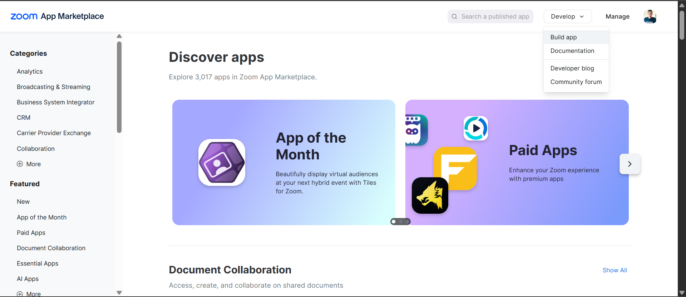
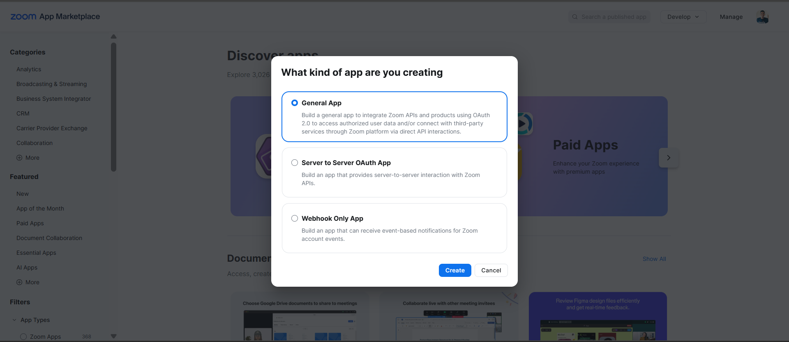
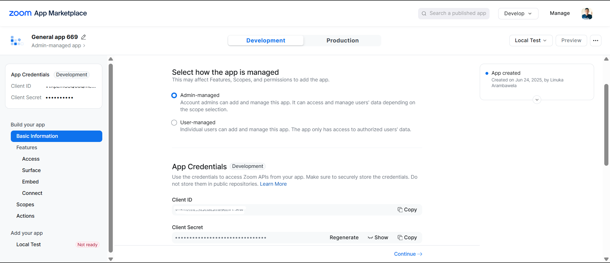
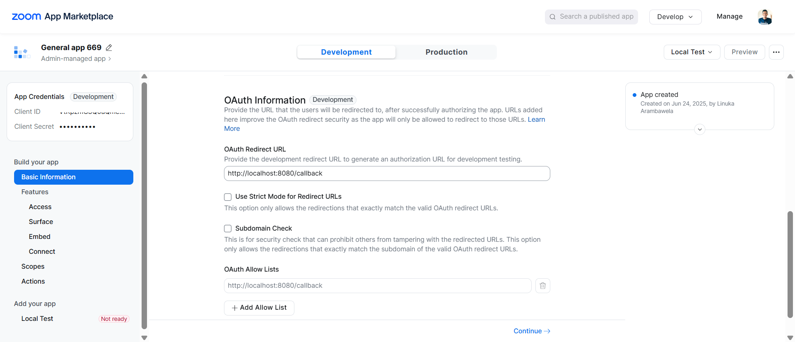
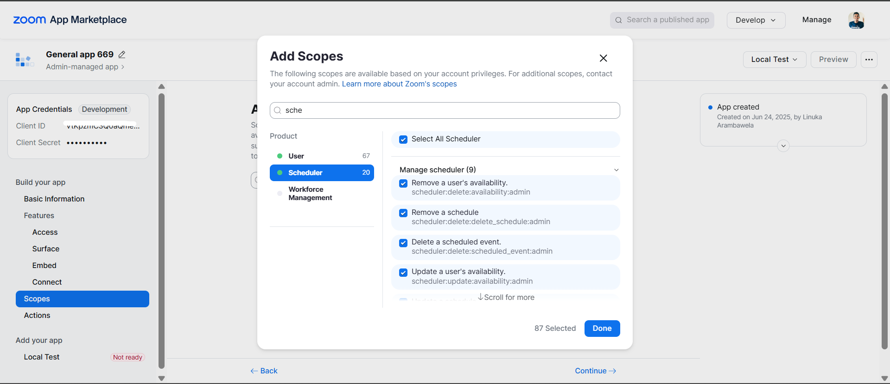
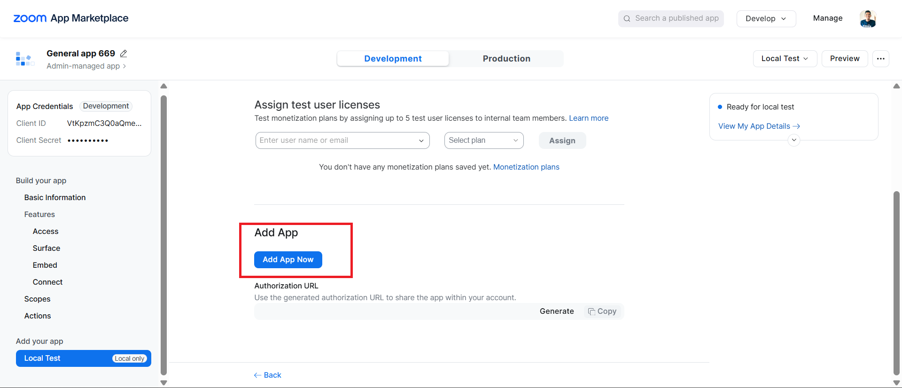

## Overview

[Zoom](https://www.zoom.com/) is a video communications platform for meetings, webinars and team chat. [Zoom Scheduler](https://developers.zoom.us/docs/zoom-scheduler/) is its booking tool: hosts publish schedules with their availability, and invitees book open time slots that become Zoom meetings.

The Zoom Scheduler connector lets Ballerina applications manage schedules, availability, bookings and scheduled events, create single-use and customised scheduling links, and read routing-form responses and booking analytics. It supports version 2 of the Zoom Scheduler API.

### Key features

- Publish and manage booking schedules, including buffers, custom questions and weekly availability rules
- Maintain users' working-hour availability and date-specific overrides
- Find open time slots and book them on behalf of invitees
- Track, update and cancel scheduled events and their attendees
- Issue single-use and customised scheduling links, and report on routing forms and booking analytics

## Setup guide

To use the Zoom Scheduler connector, you must have access to the Zoom API through [Zoom Marketplace](https://marketplace.zoom.us/) and a project under it. If you do not have a Zoom account, you can sign up for one [here](https://zoom.us/signup#/signup).

### Step 1: Create a new app

1. Open the [Zoom Marketplace](https://marketplace.zoom.us/).

2. Click "Develop" → "Build App"

   

3. Choose **"General App"** app type (for user authorization with refresh tokens)

   

4. Fill in basic information

### Step 2: Configure OAuth settings

1. **Note down your credentials**:
   * Client ID
   * Client Secret

   

2. **Set redirect URI**: Add your application's redirect URI (e.g., `http://localhost:8080/callback`)

   

3. **Add scopes**: Make sure your Zoom app has the necessary scopes for the Scheduler API:
   * Add `scheduler:read`, `scheduler:write` and `user:read` in the scope

   

### Step 3: Activate the app

1. Complete all required information
2. Activate the app

   

### Step 4: Get user authorization

1. **Direct users to authorization URL** (replace `YOUR_CLIENT_ID` and `YOUR_REDIRECT_URI`):
```
https://zoom.us/oauth/authorize?response_type=code&client_id=YOUR_CLIENT_ID&redirect_uri=YOUR_REDIRECT_URI&scope=scheduler:read scheduler:write user:read
```

2. **User authorizes the app** and gets redirected to your callback URL with an authorization code

3. **Exchange authorization code for tokens**:

```curl
curl -X POST https://zoom.us/oauth/token \
  -H "Authorization: Basic $(echo -n 'CLIENT_ID:CLIENT_SECRET' | base64)" \
  -d "grant_type=authorization_code&code=AUTHORIZATION_CODE&redirect_uri=YOUR_REDIRECT_URI"
```

This returns both `access_token` and `refresh_token`.

Replace:
* `CLIENT_ID` with your app's Client ID
* `CLIENT_SECRET` with your app's Client Secret
* `AUTHORIZATION_CODE` with the code received from the callback
* `YOUR_REDIRECT_URI` with your configured redirect URI

### Step 5: Verify your setup

```curl
curl -X GET "https://api.zoom.us/v2/users/me" \
  -H "Authorization: Bearer YOUR_ACCESS_TOKEN"
```
This will give you the user ID needed for API calls.

## Quickstart

To use the Zoom Scheduler connector in your Ballerina application, update the `.bal` file as follows:

### Step 1: Import the module

Import the `zoom.scheduler` module.

```ballerina
import ballerinax/zoom.scheduler as zoom;
```

### Step 2: Instantiate a new connector

1. Create a `Config.toml` file and configure the credentials obtained in the steps above:

```toml
clientId = "<Client ID>"
clientSecret = "<Client Secret>"
refreshToken = "<Refresh Token>"
refreshUrl = "https://zoom.us/oauth/token"
userId = "<Zoom User ID>"
```

2. Create a `zoom:ConnectionConfig` with the OAuth 2.0 refresh-token credentials and initialize the connector with it.

```ballerina
configurable string clientId = ?;
configurable string clientSecret = ?;
configurable string refreshToken = ?;
configurable string refreshUrl = ?;
configurable string userId = ?;

final zoom:Client zoomClient = check new ({
    auth: {
        clientId,
        clientSecret,
        refreshToken,
        refreshUrl
    }
});
```

### Step 3: Invoke the connector operation

Now, utilize the available connector operations.

#### List the user's schedules

```ballerina
public function main() returns error? {
    zoom:ScheduleList _ = check zoomClient->listSchedules(userId = userId, pageSize = 10);
}
```

### Step 4: Run the Ballerina application

```bash
bal run
```

## Examples

The Zoom Scheduler connector provides practical examples illustrating usage in various scenarios. Explore these [examples](https://github.com/ballerina-platform/module-ballerinax-zoom.scheduler/tree/main/examples/), covering the following use cases:

1. [Schedule slot booking](https://github.com/ballerina-platform/module-ballerinax-zoom.scheduler/tree/main/examples/schedule_slot_booking) - Create a booking page, find the first open slot in a time window, book it for an invitee and issue a single-use scheduling link.

2. [Availability hours review](https://github.com/ballerina-platform/module-ballerinax-zoom.scheduler/tree/main/examples/availability_hours_review) - Review a user's availabilities across all pages, create missing working hours and compare booking analytics with the previous period.
